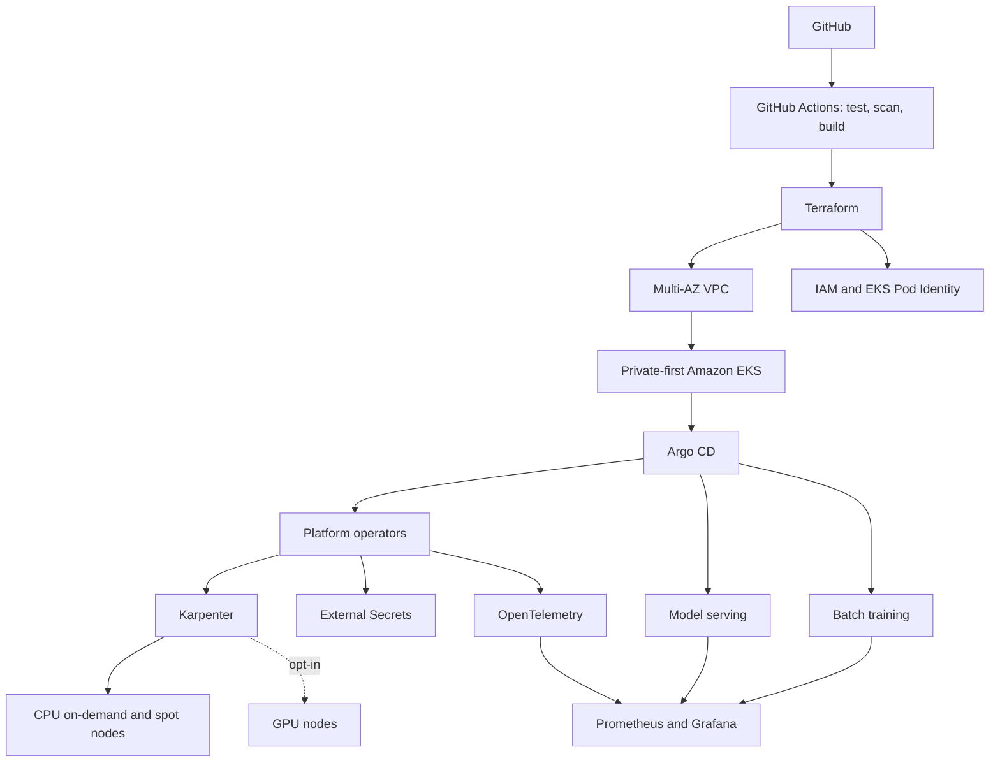

# Production-Grade AI Platform on AWS EKS

This repository is a reusable reference architecture for operating secure, observable inference and batch-training workloads on Amazon EKS. It addresses the gap between a demo model container and the infrastructure, identity, scheduling, delivery, telemetry, recovery, and policy controls required to run it responsibly.

## Architecture



Terraform owns AWS infrastructure and cluster bootstrap. Argo CD owns in-cluster desired state. CI validates and publishes artifacts but does not deploy workloads with `kubectl`, preserving Git as the auditable source of truth.

## What this repository provides

This is an implementation-oriented platform reference, not a hosted service or one-command production deployment. It provides:

- reusable AWS infrastructure modules and complete environment compositions;
- secure EKS bootstrap capacity and workload-driven CPU/Spot provisioning;
- GitOps definitions for the platform controllers and example workloads;
- an instrumented, deterministic inference API that runs without downloading a model;
- an inexpensive CPU batch job plus separate opt-in GPU examples;
- CI validation, IaC and container scanning, supply-chain metadata, tests, and operational documentation.

Operators must still provide AWS accounts, remote state, network connectivity to the private cluster endpoint, repository and image locations, IAM principal ARNs, application secrets, DNS/TLS, alert receivers, and a durable traces/logs backend. These are environment-specific integrations and intentionally are not represented by real identifiers or credentials in this repository.

## Technology choices

- EKS provides a managed Kubernetes control plane and native IAM, VPC, KMS, and CloudWatch integration.
- Terraform modules create reproducible environment roots for dev, stage, and prod.
- Argo CD continuously reconciles platform operators and workloads.
- Karpenter creates right-sized on-demand or spot nodes from pod scheduling constraints.
- External Secrets keeps secret values out of Git; EKS Pod Identity removes static AWS credentials.
- OpenTelemetry, Prometheus, and Grafana provide portable traces, metrics, dashboards, and alerting foundations.
- Kustomize supplies environment overlays without duplicating shared manifests.

The rationale and trade-offs are recorded in [architecture decisions](docs/decisions/).

## Environment model

| Environment | VPC CIDR | NAT design | System nodes | Log retention | GPU fallback |
| --- | --- | --- | --- | --- | --- |
| dev | `10.42.0.0/16` | one shared NAT gateway | 2 desired | 365 days | disabled |
| stage | `10.43.0.0/16` | one shared NAT gateway | 2 desired | 365 days | disabled |
| prod | `10.44.0.0/16` | one NAT gateway per AZ | 3 desired | 365 days | disabled |

Each environment has its own Terraform root and GitOps overlay. Promotion should move the same immutable image digest through dev, stage, and prod rather than rebuilding the image in each environment.

## Repository structure

```text
terraform/modules/       VPC, EKS, IAM, Karpenter, observability, optional GPU modules
terraform/environments/  Isolated dev, stage, and prod roots
kubernetes/base/         Namespaces, quotas, limits, priority, and network policy
kubernetes/platform/     Argo CD, Karpenter, External Secrets, OTel, Prometheus, Grafana
kubernetes/workloads/    Model-serving and batch-training examples
gitops/                   Environment-specific Kustomize desired state
src/model_server/         Typed, instrumented example inference API
tests/                    Behavioral application tests
docs/                     Architecture, security, networking, recovery, and ADRs
.github/workflows/        Validation, security, and supply-chain workflows
```

## Documentation map

Start with the cross-cutting design documents:

- [Architecture](docs/architecture.md) explains system boundaries, workload classes, availability, and data flow.
- [Networking](docs/networking.md) describes public/private subnet roles, endpoints, and policy layers.
- [Security](docs/security.md) summarizes identity, encryption, secrets, network isolation, and supply-chain controls.
- [Disaster recovery](docs/disaster-recovery.md) defines the infrastructure and GitOps recovery order.
- [Architecture decisions](docs/decisions/) capture why EKS, Karpenter, Argo CD, OpenTelemetry, and EKS Pod Identity were selected.
- [Engineering standards](ENGINEERING.md) define the repository conventions and definition of done.
- [GitHub automation](.github/README.md) explains Dependabot, validation, security scanning, and container publishing workflows.

Component-specific operational guides:

- Terraform: [VPC](terraform/modules/vpc/README.md), [EKS](terraform/modules/eks/README.md), [workload IAM](terraform/modules/iam/README.md), [Karpenter IAM](terraform/modules/karpenter/README.md), [observability](terraform/modules/observability/README.md), and [optional GPU nodes](terraform/modules/gpu-nodes/README.md).
- Kubernetes: [Argo CD](kubernetes/platform/argocd/README.md), [External Secrets](kubernetes/platform/external-secrets/README.md), [OpenTelemetry](kubernetes/platform/otel/README.md), [Prometheus](kubernetes/platform/prometheus/README.md), and [Grafana](kubernetes/platform/grafana/README.md).

## Local validation

Install Python 3.11+, Terraform 1.6+, `kubectl`, and `kubeconform`, then install development dependencies:

```bash
python3 -m venv .venv
. .venv/bin/activate
pip install -e '.[dev]'
make check-tools
make test
make validate ENV=dev
```

Run `make security` when Checkov, Trivy, and Gitleaks are installed. CI runs equivalent checks for every pull request.

The most useful Make targets are:

| Command | Purpose |
| --- | --- |
| `make test` | Run model-server behavior tests. |
| `make lint` | Check Python lint and Terraform formatting. |
| `make terraform-validate ENV=dev` | Initialize and validate one environment composition. |
| `make k8s-validate` | Render all overlays and validate Kubernetes schemas. |
| `make security` | Run Checkov, Trivy, and Gitleaks. |
| `make plan ENV=dev` | Produce a reviewed Terraform plan. |
| `make deploy ENV=dev` | Apply the selected environment. |
| `make destroy ENV=dev` | Destroy the selected environment after dependency cleanup. |

## Deployment

1. Create a versioned, encrypted S3 state bucket and locking mechanism outside this stack, then configure the backend in each environment root.
2. Copy `terraform/environments/<env>/terraform.tfvars.example` to an untracked `.tfvars` file. Replace placeholders and supply at least one reviewed administrator role ARN.
3. Review cost and network settings. Public EKS API access and GPU capacity are off by default.
4. Provision infrastructure:

   ```bash
   make plan ENV=dev
   make deploy ENV=dev
   aws eks update-kubeconfig --name eks-ai-platform-dev --region us-east-1
   ```

5. Confirm that the configured GitHub repository and GHCR package names match the repository created for this project. Install Argo CD once, then bootstrap the root applications:

   ```bash
   kubectl apply -n argocd -f kubernetes/platform/argocd/applications.yaml
   ```

6. Update the chart versions and environment-specific Karpenter settings through a reviewed pull request. Argo CD then owns reconciliation.

The example Argo CD root Application is configured for dev. Stage and prod bootstrap must point `platform-config` at their respective `gitops/stage` or `gitops/prod` path and set the matching Karpenter cluster name. Do not apply the dev root unchanged to another cluster.

Production changes should run through a protected GitHub environment with required reviewers; do not run `make deploy ENV=prod` from an unreviewed workstation.

## Security

Workers have no public IPs. The EKS endpoint is private by default, Kubernetes secrets use a rotating KMS key, all control-plane log types are enabled, IMDSv2 is required, service-account tokens are disabled when unnecessary, and containers run non-root with read-only filesystems and dropped capabilities. Default-deny NetworkPolicies and quotas constrain workload namespaces. IAM access is explicit through EKS access entries and Pod Identity.

VPC flow logs are encrypted with a dedicated KMS key and retained for 365 days. The default VPC security group has no ingress or egress rules, and endpoint security groups expose only TLS inside the VPC boundary.

Runtime secret values belong in AWS Secrets Manager. The example `ClusterSecretStore` contains only a reference and must be associated with a least-privilege External Secrets identity. See [security.md](docs/security.md) for the threat-control mapping.

## Observability

The model API exposes `/metrics`, `/healthz`, and `/readyz`; emits structured JSON with timestamp, service, environment, severity, request ID, and latency; and exports spans over OTLP when configured. The collector batches telemetry and exposes Prometheus-compatible metrics. `ServiceMonitor` and Grafana dashboard resources demonstrate discovery and visualization without coupling the application to a vendor.

The default collector sends traces to a debug exporter and exposes received metrics for Prometheus. It does not provide durable trace or log storage. Select an approved backend, authentication method, retention policy, and Pod Identity permissions before production use.

## Cost considerations

EKS control planes, NAT gateways, VPC endpoints, log ingestion, load balancers, and compute incur charges. Dev and stage use one NAT gateway to reduce cost; prod defaults to one per AZ for resilience. Spot capacity is intended for interruption-tolerant work. GPU manifests are examples only, the Terraform GPU fallback is disabled by default, and its desired size is zero even when enabled.

## Failure scenarios

- A node or AZ loss is absorbed by multi-AZ subnets, topology spreading, replicas, and disruption budgets.
- Spot interruption causes Karpenter replacement; batch jobs retry up to their configured limit.
- An unavailable telemetry backend should not block inference; collector queues, sampling, and durable exporters must be sized for the chosen backend.
- Argo CD or operator failure leaves existing workloads running while reconciliation is restored.
- Regional or state loss follows the ordered procedure in [disaster-recovery.md](docs/disaster-recovery.md). Stateful model artifacts and training data require separate versioned storage and recovery objectives.

## Cleanup

Delete externally created load balancers and persistent volumes first, allow Argo CD finalizers to complete, and then review and destroy the environment:

```bash
make plan ENV=dev
make destroy ENV=dev
```

Confirm that NAT gateways, elastic IPs, log groups, secrets, image repositories, state storage, and backups are either intentionally retained or removed. Never delete the remote state backend until all managed resources are confirmed gone.

## Contributing, security, and license

Use [CONTRIBUTING.md](CONTRIBUTING.md) for the development and pull-request workflow. Report vulnerabilities through the private process in [SECURITY.md](SECURITY.md), not a public issue. The reference implementation is licensed under the [Apache License 2.0](LICENSE).
